# Magic Mirror

**Real-time camera effects built entirely with classic computer vision.**

**Live demo:** [magic-mirror-wszt9zjekbyt4kmsmej5jl.streamlit.app](https://magic-mirror-wszt9zjekbyt4kmsmej5jl.streamlit.app/)

Magic Mirror is a Streamlit application that turns a webcam, a photo or a video into a playground of
"spells": an invisibility cloak, drawing in the air, face filters, a motion alarm and artistic filters.
There is **no deep learning and no pretrained model** anywhere in the project. Every effect is a short,
readable pipeline of OpenCV operations: color spaces, masking, filtering, edges, contours and Haar cascades.

The app is also built for teaching. Each spell exposes every intermediate image it produces, so the
**Under the hood** tab shows exactly how the result was made, step by step.

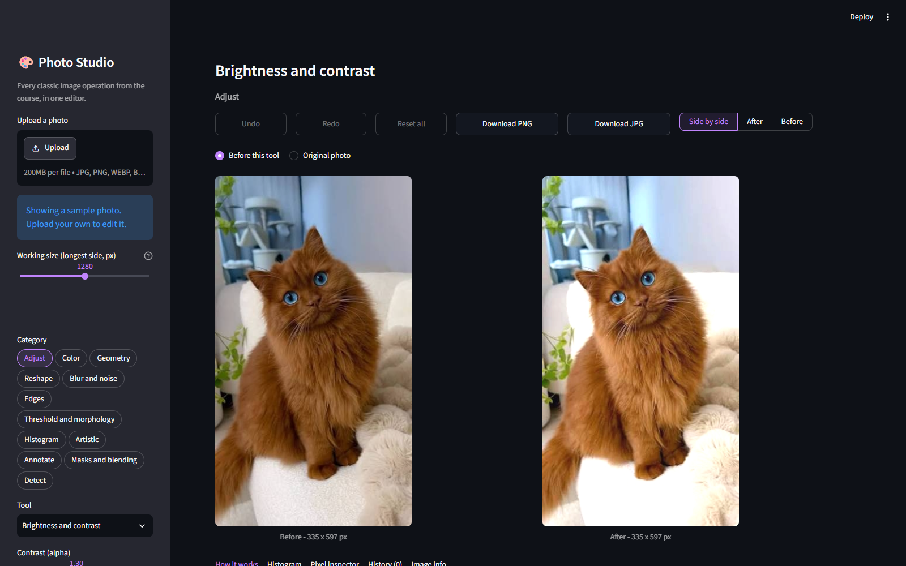

---

## Table of contents

1. [Features](#features)
2. [The five spells](#the-five-spells)
3. [Architecture](#architecture)
4. [How a frame flows through the app](#how-a-frame-flows-through-the-app)
5. [Spell pipelines in detail](#spell-pipelines-in-detail)
6. [Concepts covered](#concepts-covered)
7. [Project structure](#project-structure)
8. [Getting started](#getting-started)
9. [Using the app](#using-the-app)
10. [Deploying to Streamlit Community Cloud](#deploying-to-streamlit-community-cloud)
11. [Design decisions and edge cases](#design-decisions-and-edge-cases)
12. [Extending: add your own spell](#extending-add-your-own-spell)
13. [Troubleshooting](#troubleshooting)
14. [Tech stack](#tech-stack)

---

## Features

| Area | What you get |
|---|---|
| Spells | Five independent effects, each in its own module |
| Input sources | Live webcam (WebRTC), single camera snapshot, image upload, video upload |
| Live controls | Every threshold, kernel size and color range is a sidebar slider, so changes are visible immediately |
| Under the hood | Every intermediate image of the current frame, plus a color histogram of the result |
| How it works | A plain-language explanation of each spell and the exact source code it runs |
| Gallery | Save snapshots during a session and download them as PNG |
| Video export | Process an uploaded video frame by frame and download the result |
| Performance | Adjustable processing width, a half-resolution fast mode and an on-screen FPS counter |

---

## The five spells

| Spell | What it does | Core techniques |
|---|---|---|
| **Invisibility cloak** | Anything covered by a solid-colored cloth disappears and the background shows through | HSV `inRange`, morphological opening, `bitwise_and`, median background |
| **Air drawing** | Move a brightly colored pen cap and draw lines in the air | Color tracking, largest contour, image moments, position smoothing |
| **Face filters** | Sunglasses, mustache and crown stickers, or pixelate and blur faces for privacy | Haar cascades, histogram equalization, alpha blending, resizing |
| **Motion alarm** | Draws boxes around anything that moves and counts alarms | Running-average background, `absdiff`, thresholding, contours |
| **Art filters** | Cartoon, pencil sketch, vintage, emboss and neon edges | Bilateral filter, adaptive threshold, color dodge, `filter2D`, Canny |

<p align="center">
  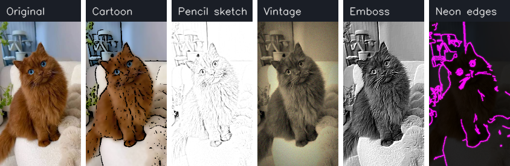
  <br><em>Art filters on the same input: original, cartoon, pencil sketch, vintage, emboss and neon edges.</em>
</p>

---

## Architecture

The application is split into three layers. The **UI layer** (`app.py`) knows about Streamlit and
input sources. The **spell layer** (`spells/`) knows only about images: every spell receives a BGR frame and
returns a result plus its intermediate steps. The **core layer** (`core/`) holds small reusable OpenCV helpers.

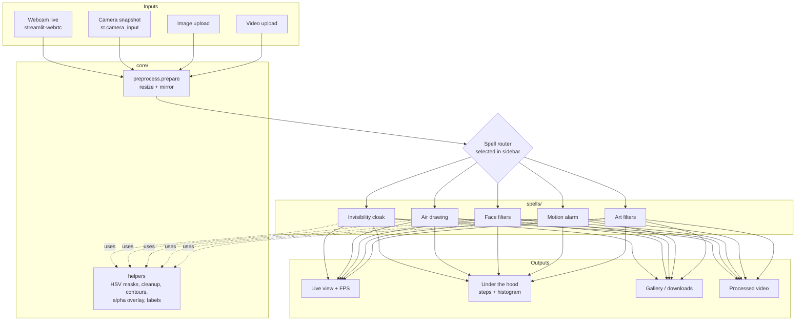

### The spell contract

Every spell implements the same small interface, which is what lets the UI, the Under the hood tab and
the video exporter work with any spell without special cases.

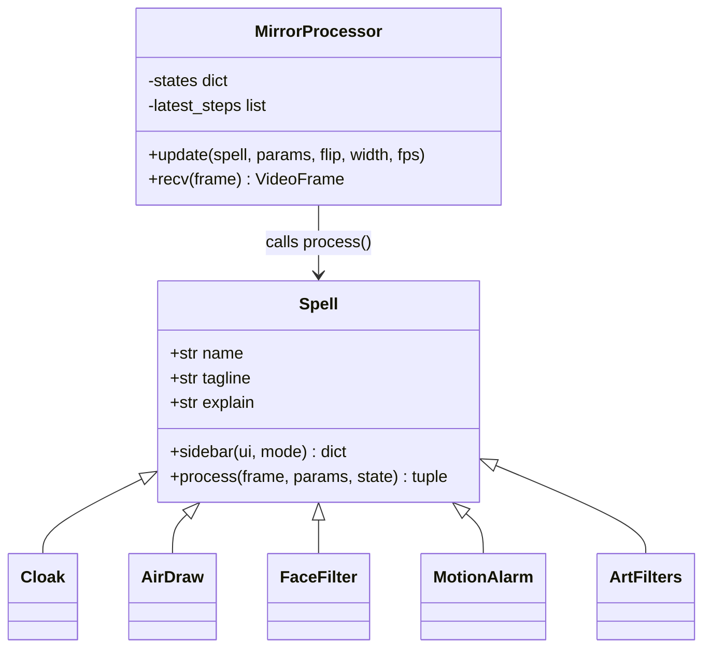

- `sidebar(ui, mode)` draws the spell's own controls and returns them as a `params` dict.
- `process(frame, params, state)` returns `(result_bgr, [(step_title, image), ...])`.
- `state` is a dictionary owned by the spell that survives between frames. It stores things like the
  captured background, the drawing strokes or the motion model.

---

## How a frame flows through the app

### Live webcam

In live mode, frames are processed in a background thread owned by `streamlit-webrtc`, while the sidebar runs
in Streamlit's script thread. The two threads share settings through a lock, and button clicks are passed as
counters so the worker thread can detect each new click exactly once.

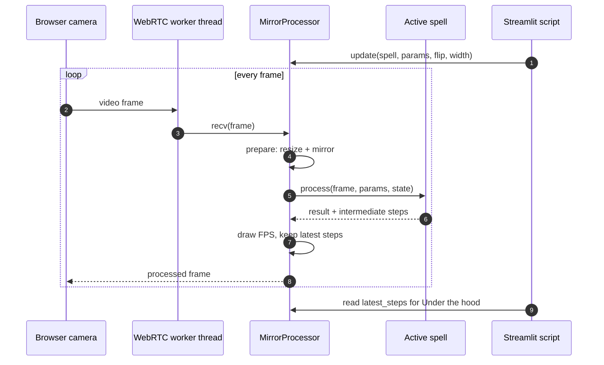

### Uploaded video

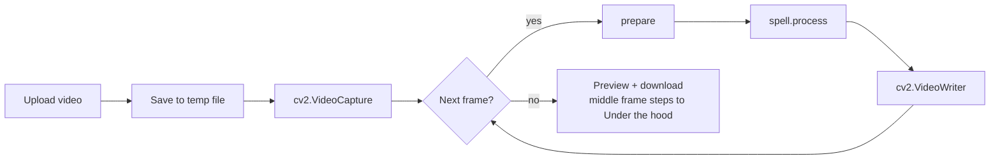

The writer tries codecs in order of browser support (`avc1`, then `VP80` WebM, then `mp4v`) and uses the first
one the installed OpenCV build can open.

---

## Spell pipelines in detail

Every image below was generated by running the real spell code from this repository.

### Invisibility cloak

<p align="center">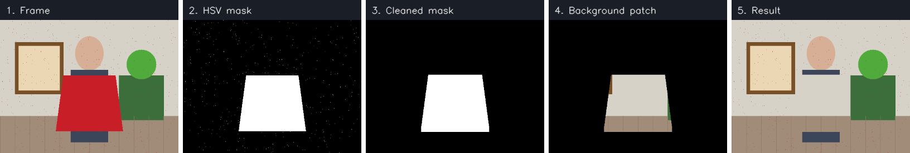</p>

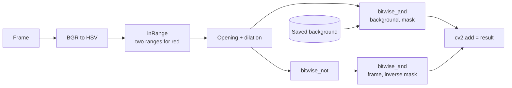

**Capturing the background.** In live mode the background is not a single frame. After a three-second
countdown the spell collects 30 frames and takes their per-pixel **median**, which removes sensor noise and
anything that moved during capture.

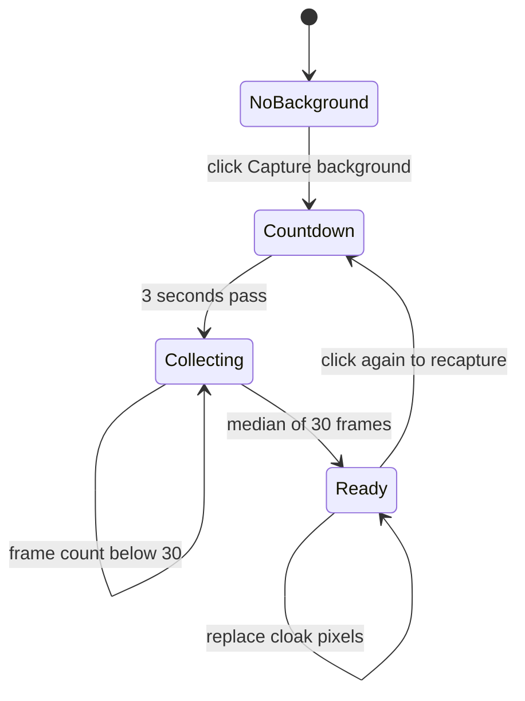

In snapshot and upload modes the current photo (or an uploaded image) becomes the background. In video mode the
median of the first 30 frames is used automatically.

**Why red needs two ranges.** OpenCV stores hue from 0 to 179 on a circle, and red sits at both ends of it.
The red preset therefore combines `0-10` and `170-179` with a bitwise OR.

### Air drawing

<p align="center">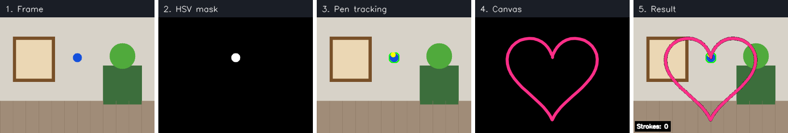</p>

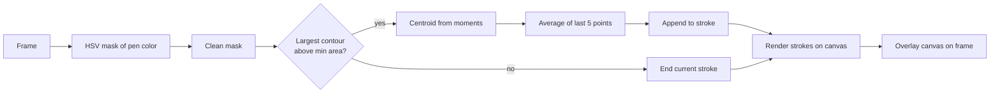

- Lifting the pen out of view ends the stroke, so you can write separate letters.
- **Undo** removes the last stroke and **Clear** empties the canvas.
- Brush color and thickness are stored per stroke, so changing them does not repaint older lines.

### Face filters

<p align="center">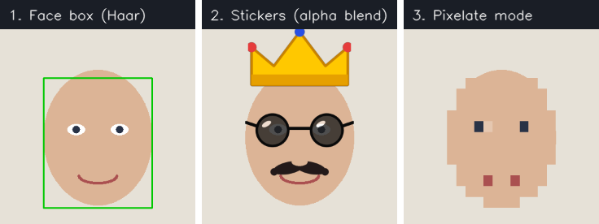</p>

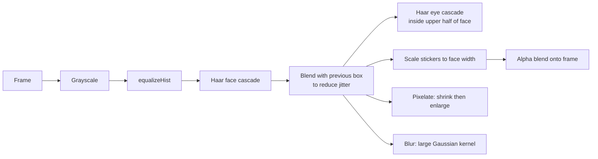

The stickers are drawn with OpenCV primitives into transparent BGRA images at startup, so the project ships
without any image assets. Blending uses the alpha channel: `out = alpha * sticker + (1 - alpha) * frame`.

### Motion alarm

<p align="center">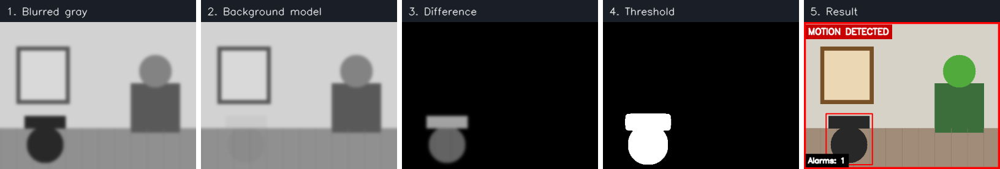</p>

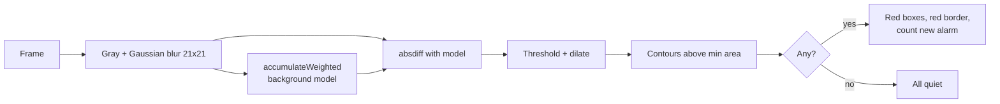

The background model adapts slowly (adjustable speed), so gradual lighting changes are absorbed while real
movement still stands out. An alarm is counted only on the transition from quiet to moving, not on every frame.

### Art filters

<p align="center">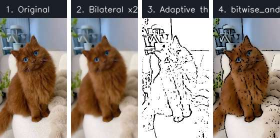</p>

| Style | Pipeline |
|---|---|
| Cartoon | Bilateral filter twice (flattens colors, keeps edges), median blur and adaptive threshold for ink lines, then `bitwise_and` |
| Pencil sketch | Grayscale, invert, Gaussian blur, then color dodge: `gray / (255 - blurred_inverse) * 256` |
| Vintage | 3x3 sepia color matrix with `cv2.transform`, Gaussian vignette, light film grain |
| Emboss | Custom 3x3 directional kernel with `cv2.filter2D` |
| Neon edges | Canny edges, dilated and colored in HSV, blurred into a glow and added over a darkened frame |

All styles share brightness and contrast controls (`convertScaleAbs`, that is `alpha * img + beta` with clipping)
and an optional fast mode that processes at half resolution and scales the result back up.

---

## Concepts covered

The project was designed to bring together the classic computer vision topics of the course in one application.

| Topic | Where it is used |
|---|---|
| Reading images and video, color spaces (BGR, RGB, HSV, gray) | All sources, every color mask |
| Image geometry: resize, flip, crop, ROI | `prepare`, sticker scaling, pixelation |
| Image arithmetic and blending | `cv2.add`, color dodge, alpha blending |
| Bitwise operations and masking | Invisibility cloak, cartoon, canvas overlay |
| Brightness, contrast, histograms | Art filter controls, histogram equalization, result histogram |
| Noise removal and smoothing | Gaussian, median and bilateral filters |
| Morphology | Opening and dilation for mask cleanup |
| Edge detection | Canny, adaptive threshold edges, emboss kernel |
| Thresholding | Motion mask, cartoon ink lines |
| Contours and moments | Pen tracking, motion boxes |
| Color tracking | Cloak and pen detection |
| Motion detection | Running average and frame differencing |
| Haar cascades | Face and eye detection |
| Video writing | Processed video export |

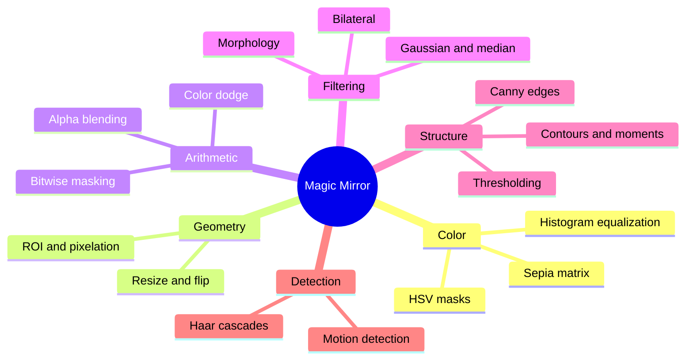

---

## Project structure

```
magic_mirror/
├── app.py                  Streamlit UI: sidebar, tabs, webcam, image and video handling
├── core/
│   ├── preprocess.py       resize + mirror, image decoding, BGR to RGB
│   └── helpers.py          HSV masks, mask cleanup, contours, alpha overlay, text labels
├── spells/
│   ├── __init__.py         registry of all spells
│   ├── base.py             Spell interface, action buttons, shared color controls
│   ├── cloak.py            Invisibility cloak
│   ├── air_draw.py         Air drawing
│   ├── face_filter.py      Face filters and generated stickers
│   ├── motion_alarm.py     Motion alarm
│   └── art_filters.py      Cartoon, pencil, vintage, emboss, neon
├── docs/images/            Pipeline images used in this README
├── .streamlit/config.toml  Theme and upload size
└── requirements.txt
```

---

## Getting started

**Requirements:** Python 3.10 or newer and a webcam for live mode.

```bash
git clone https://github.com/Hagar-Ghazi/magic-mirror.git
cd magic-mirror
python -m venv .venv
```

Activate the environment:

```bash
# Windows
.venv\Scripts\activate
# macOS / Linux
source .venv/bin/activate
```

Install and run:

```bash
pip install -r requirements.txt
streamlit run app.py
```

The app opens at `http://localhost:8501`.

> OpenCV is pinned below version 5 on purpose. OpenCV 5 moved Haar cascades out of the main package, and the
> face filters depend on them.

---

## Using the app

1. **Choose a source** in the sidebar: Webcam live, Camera snapshot, Upload image or Upload video.
2. **Choose a spell** and tune its settings. Changes apply to the next frame.
3. Watch the **Live** tab, then open **Under the hood** to see each intermediate image.
4. Save results to the **Gallery** or download them.

Tips for the best results:

| Spell | Tip |
|---|---|
| Invisibility cloak | Use a single bright color that appears nowhere else in the scene, keep the camera still, and step out of view while the background is captured |
| Air drawing | A small, saturated object works best (a blue or green bottle cap). Raise "Min pen size" if other objects get detected |
| Face filters | Face the camera with even lighting. Raise "Min neighbors" to remove false detections |
| Motion alarm | Keep the camera fixed. Raise "Min moving area" to ignore small movements such as curtains |
| Art filters | Turn on fast mode in live video for a smoother frame rate |

---

## Deploying to Streamlit Community Cloud

1. Push this repository to GitHub.
2. Sign in at [share.streamlit.io](https://share.streamlit.io) with your GitHub account.
3. Click **Create app**, choose this repository, branch `main` and main file `app.py`.
4. Deploy. Dependencies are installed from `requirements.txt`, which uses `opencv-python-headless`
   because cloud servers have no display.

### Enabling live webcam on the cloud (TURN server)

WebRTC tries to connect the browser and the server directly. On Streamlit Cloud that usually fails behind
NAT and firewalls, and the app shows *"Connection is taking longer than expected"*. A **TURN server** fixes
this by relaying the video. The app reads TURN credentials from the app secrets; the free option is a
Hugging Face token:

1. Create a free account at [huggingface.co](https://huggingface.co) and open
   **Settings, Access Tokens**. Create a token with the **Read** role.
2. In Streamlit Cloud open your app, then **Settings, Secrets**, and add:

   ```toml
   HF_TOKEN = "hf_your_token_here"
   ```

3. Save. The app restarts and live video connects through the TURN relay.


Cloudflare (`CLOUDFLARE_TURN_KEY_ID` and `CLOUDFLARE_TURN_KEY_API_TOKEN`) and Twilio
(`TWILIO_ACCOUNT_SID` and `TWILIO_AUTH_TOKEN`) credentials work the same way. Never commit these values to
the repository. Without a TURN server, **Camera snapshot** mode still works everywhere because it sends
single photos over normal HTTP.

---

## Design decisions and edge cases

| Situation | How it is handled |
|---|---|
| Spell raises an error in live mode | The error is printed on the frame and the stream keeps running |
| Background captured with you still in view | Three-second countdown, then a median of 30 frames removes moving content |
| Red cloak color | Two hue ranges joined with bitwise OR |
| Noisy masks | Morphological opening and dilation with an adjustable kernel |
| Pen leaves the frame | The current stroke ends instead of drawing a jump across the screen |
| Shaky pen or face boxes | Point averaging for the pen, blending with the previous box for faces |
| No face found | A clear on-screen message instead of a silent failure |
| Gradual lighting changes | Slowly adapting running-average background in the motion alarm |
| Slow filters | Adjustable processing width, half-resolution fast mode, FPS counter |
| Button clicks across threads | Clicks are counters; each spell reacts once to each new value |
| Browser cannot play the video codec | Codec fallback chain and a download button |
| Webcam blocked or unavailable | Snapshot and upload modes work without WebRTC |

---

## Extending: add your own spell

1. Create `spells/my_spell.py`:

```python
import cv2
from spells.base import Spell


class Grayscale(Spell):
    name = "Grayscale"
    icon = ""
    tagline = "The simplest spell."
    explain = "Converts the frame to gray with `cv2.cvtColor`."

    def sidebar(self, ui, mode):
        return {"keep_edges": ui.toggle("Overlay edges", False)}

    def process(self, frame, params, state):
        gray = cv2.cvtColor(frame, cv2.COLOR_BGR2GRAY)
        result = cv2.cvtColor(gray, cv2.COLOR_GRAY2BGR)
        if params["keep_edges"]:
            result[cv2.Canny(gray, 80, 160) > 0] = (0, 255, 255)
        return result, [("Original", frame), ("Gray", gray)]
```

2. Register it in `spells/__init__.py` by adding `Grayscale()` to `ALL_SPELLS`.

The new spell automatically gets the live view, Under the hood, Gallery, How it works and video export.

---

## Troubleshooting

| Problem | Fix |
|---|---|
| `AttributeError: module 'cv2' has no attribute 'CascadeClassifier'` | OpenCV 5 is installed. Run `pip install "opencv-python-headless<5"` |
| "Connection is taking longer than expected" | No TURN server. Add `HF_TOKEN` to the app secrets (see deployment section), or switch to Camera snapshot |
| Cloak removes parts of the room too | The cloak color appears elsewhere. Pick another color or raise the minimum saturation |
| Pen is not detected | Use the Under the hood tab to inspect the HSV mask, then adjust the color sliders |
| Low frame rate | Lower the processing width or enable fast mode |

---

## Tech stack

| Library | Role |
|---|---|
| [Streamlit](https://streamlit.io) | Web interface |
| [streamlit-webrtc](https://github.com/whitphx/streamlit-webrtc) | Real-time webcam streaming |
| [OpenCV](https://opencv.org) | All image processing |
| [NumPy](https://numpy.org) | Array operations |
| [PyAV](https://github.com/PyAV-Org/PyAV) | Video frame conversion for WebRTC |
| [pandas](https://pandas.pydata.org) | Histogram chart data |

---

Built as a project for the ITI *Computer Vision and Pretrained Models* course, using only the classic
computer vision part of the material.
