# Photo Studio

**A complete photo editor built only with classic computer vision.**

Photo Studio is a Streamlit application that lets you upload a photo and edit it from every angle: light
and color, geometry, body and face reshaping, blur and noise, edges, thresholds, histograms, artistic
filters, text, emoji, borders, masks and object detection. It has **73 tools in 12 categories**, and every
one is a short, readable pipeline of OpenCV and NumPy operations. There is **no deep learning and no
pretrained model** anywhere in the project.

The editor is also built for teaching. Every tool explains what it does and shows its own source code,
and the histogram, pixel inspector and before/after views make the effect of each operation visible.

---

## Table of contents

1. [Highlights](#highlights)
2. [Tool catalog](#tool-catalog)
3. [Architecture](#architecture)
4. [How editing works](#how-editing-works)
5. [Concepts covered](#concepts-covered)
6. [Project structure](#project-structure)
7. [Getting started](#getting-started)
8. [Using the editor](#using-the-editor)
9. [Deploying to Streamlit Community Cloud](#deploying-to-streamlit-community-cloud)
10. [Adding a new tool](#adding-a-new-tool)
11. [Design decisions](#design-decisions)
12. [Troubleshooting](#troubleshooting)
13. [Tech stack and credits](#tech-stack-and-credits)

---

## Highlights

| Feature | Details |
|---|---|
| 73 tools, 12 categories | Adjust, Color, Geometry, Reshape, Blur and noise, Edges, Threshold and morphology, Histogram, Artistic, Annotate, Masks and blending, Detect |
| Live preview | Every slider updates the result immediately; slow tools preview on demand |
| Non-destructive history | Edits are stored as steps. Undo, redo, remove any step or go back to any point |
| Before and after | Side by side, after only or before only; compare with the previous step or the original photo |
| Histogram panel | Blue, green, red and gray histograms before and after, with brightness and contrast metrics |
| Pixel inspector | BGR, RGB, HSV, LAB, gray and hex values of any pixel, plus a 15 x 15 zoom |
| Image info | Size, aspect ratio, NumPy shape, data type, mean color and file sizes |
| How it works | A plain explanation of each tool and the exact code it runs |
| Export | Download the result as PNG or JPG |
| Body and face reshaping | Enlarge or shrink faces, slim or widen, make a person taller, bulge, pinch and swirl |
| Text and emoji | Text at any position with fonts, outline and background box; 33 emoji with size, rotation and opacity |

---

## Tool catalog

Every image in this section was generated by running the tools from this repository on the same photo.

### Adjust

<p align="center">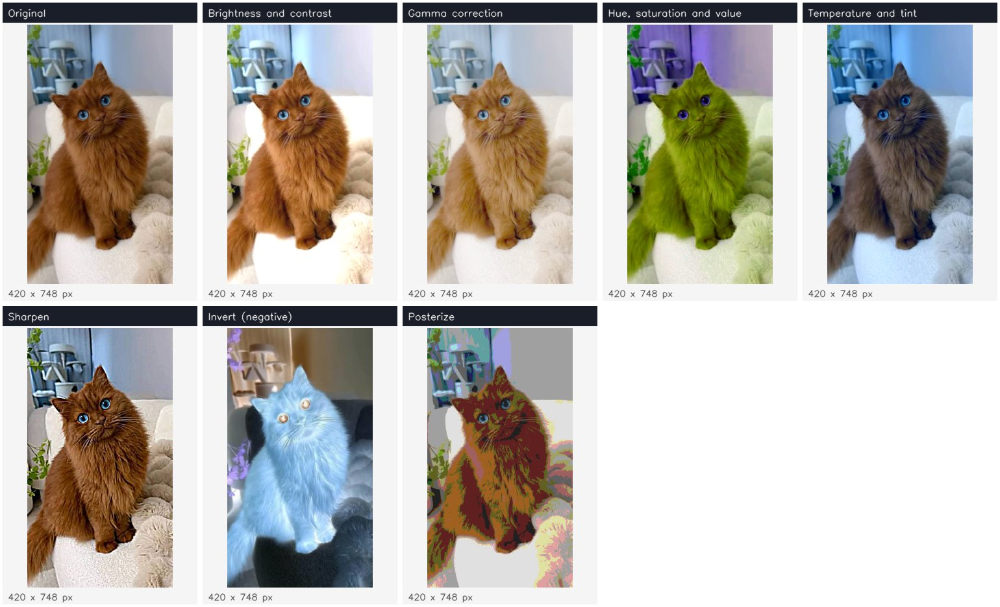</p>

| Tool | What it does | Core operations |
|---|---|---|
| Brightness and contrast | `alpha * pixel + beta` with clipping | `cv2.convertScaleAbs` |
| Gamma correction | Brightens or darkens mid-tones only | Lookup table, `cv2.LUT` |
| Hue, saturation and value | Rotates colors, makes them richer or grayer | `cvtColor` to HSV, channel math |
| Temperature and tint | Warm or cool, green or magenta | Per-channel arithmetic |
| Sharpen | Unsharp masking | `GaussianBlur`, `addWeighted` |
| Invert (negative) | `255 - pixel` | `cv2.bitwise_not` |
| Posterize | Few levels per channel | Integer division (quantization) |

### Color

<p align="center">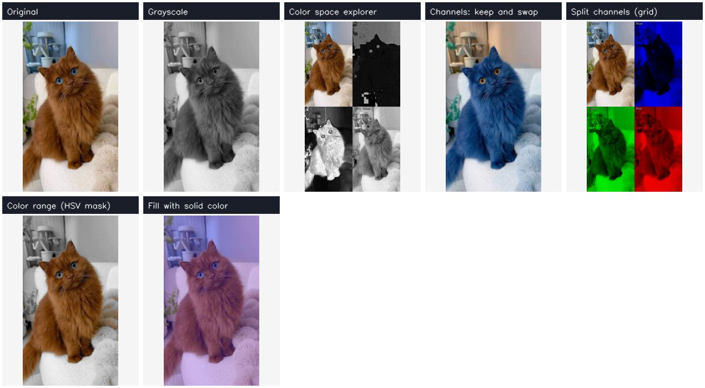</p>

| Tool | What it does | Core operations |
|---|---|---|
| Grayscale | Weighted, average, lightness or single channel | `cvtColor`, NumPy reductions |
| Color space explorer | Shows HSV, HLS, LAB, YCrCb or BGR channels in a grid | `cvtColor`, `split` |
| Channels: keep and swap | Turn channels off, reorder BGR to RGB and others | `split`, `merge` |
| Split channels (grid) | Blue, green and red planes, tinted or gray | `split`, `merge` |
| Color range (HSV mask) | Color splash, keep, remove or recolor one color | `inRange`, masking |
| Fill with solid color | Color wash over the photo | `np.full`, `addWeighted` |

### Geometry

<p align="center">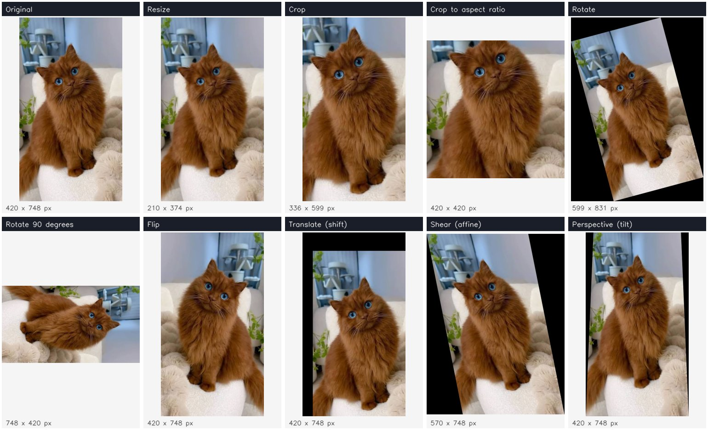</p>

| Tool | What it does | Core operations |
|---|---|---|
| Resize | By percent or exact size, five interpolation methods | `cv2.resize` |
| Crop | Any rectangle | NumPy slicing (ROI) |
| Crop to aspect ratio | 1:1, 4:3, 16:9, 9:16 and more around any center | Slicing |
| Rotate | Any angle, optional canvas growth, border modes | `getRotationMatrix2D`, `warpAffine` |
| Rotate 90 degrees | Lossless quarter turns | `cv2.rotate` |
| Flip | Horizontal, vertical or both | `cv2.flip` |
| Translate (shift) | Moves the image with a border mode | Affine matrix, `warpAffine` |
| Shear (affine) | Slants the image from three point pairs | `getAffineTransform`, `transform` |
| Perspective (tilt) | Squeezes any edge for a 3D lean | `getPerspectiveTransform`, `warpPerspective` |

### Reshape (body and face)

<p align="center">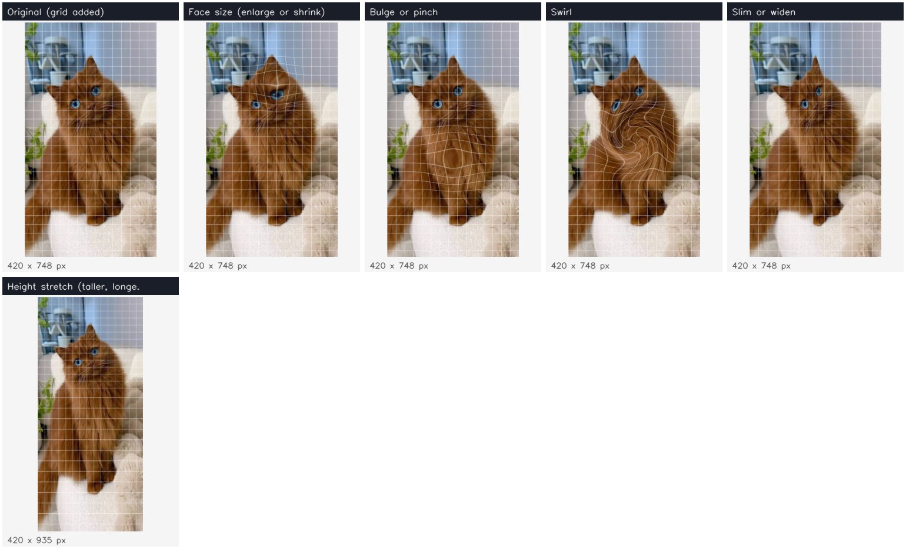</p>

| Tool | What it does | Core operations |
|---|---|---|
| Face size | Enlarges or shrinks detected faces (or any point) | Haar cascade, radial warp with `cv2.remap` |
| Bulge or pinch | Fish-eye bulge or pinch anywhere | `cv2.remap` |
| Swirl | Twists a circular area | `cv2.remap` |
| Slim or widen | Narrows or widens a body, optionally only some rows | Horizontal `cv2.remap`, feathered blending |
| Height stretch | Makes a person taller or shorter by stretching the legs region | Slicing, `cv2.resize`, `np.vstack` |

How the radial warp works: for every output pixel the tool computes *where to read from*. Reading closer to the
center magnifies, reading farther away shrinks, and the effect fades smoothly to zero at the edge of the circle.

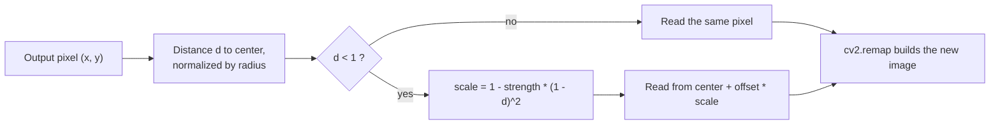

### Blur and noise

<p align="center">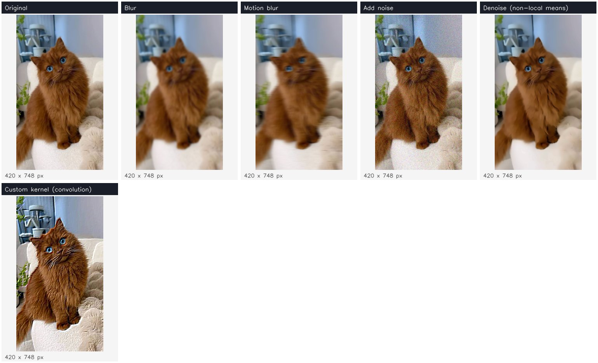</p>

| Tool | What it does | Core operations |
|---|---|---|
| Blur | Average, Gaussian, median or bilateral | `blur`, `GaussianBlur`, `medianBlur`, `bilateralFilter` |
| Motion blur | Smears along a direction | Rotated line kernel, `filter2D` |
| Add noise | Gaussian, salt and pepper or speckle, reproducible seed | NumPy random |
| Denoise | Removes noise and keeps texture | `fastNlMeansDenoisingColored` |
| Custom kernel | Any convolution kernel, with presets | `cv2.filter2D` |

### Edges

<p align="center">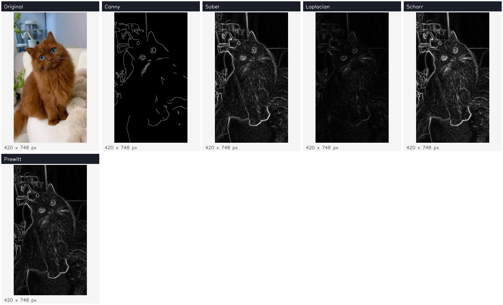</p>

| Tool | What it does | Core operations |
|---|---|---|
| Canny | Thin, clean edges with hysteresis | `cv2.Canny` |
| Sobel | First derivative in X, Y or magnitude | `cv2.Sobel` |
| Laplacian | Second derivative, all directions | `cv2.Laplacian` |
| Scharr | More accurate 3 x 3 derivative | `cv2.Scharr` |
| Prewitt | Simplest derivative kernel | `cv2.filter2D` |

Each edge tool can show the edges alone, inverted (black on white) or drawn in color over the photo.

### Threshold and morphology

<p align="center">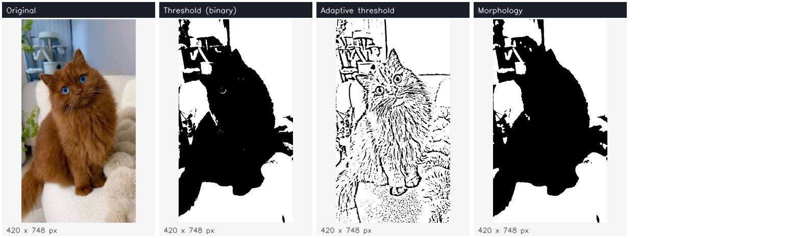</p>

| Tool | What it does | Core operations |
|---|---|---|
| Threshold (binary) | Five threshold types, manual, Otsu or Triangle | `cv2.threshold` |
| Adaptive threshold | Per-pixel threshold for uneven lighting | `cv2.adaptiveThreshold` |
| Morphology | Erode, dilate, open, close, gradient, top hat, black hat | `getStructuringElement`, `morphologyEx` |

### Histogram

<p align="center">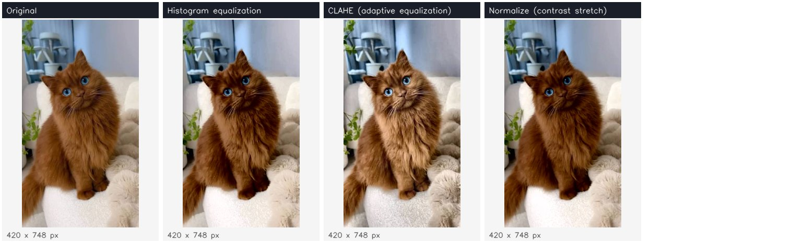</p>

| Tool | What it does | Core operations |
|---|---|---|
| Histogram equalization | On luminance, grayscale or each channel | `equalizeHist`, YCrCb |
| CLAHE | Tile-based equalization with a clip limit | `cv2.createCLAHE` |
| Normalize | Min-max contrast stretch with percentile clipping | `cv2.normalize` |

The **Histogram** panel under the image shows the effect of every tool on the distribution of pixel values.

### Artistic

<p align="center">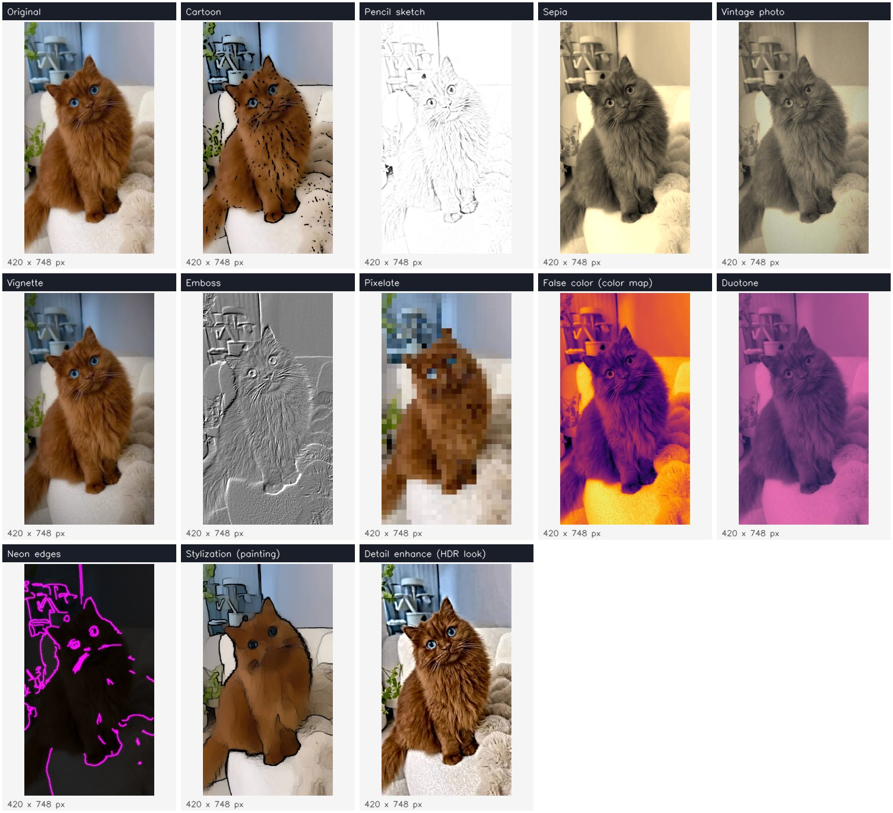</p>

| Tool | Core operations |
|---|---|
| Cartoon | Bilateral filter, adaptive threshold lines, `bitwise_and` |
| Pencil sketch | Color dodge with `cv2.divide`, gray or color |
| Sepia | 3 x 3 color matrix with `cv2.transform` |
| Vintage photo | Sepia, fade, film grain, vignette |
| Vignette | Soft radial mask, any center and color |
| Emboss | Directional kernel, gray or colored relief |
| Pixelate | Whole image, detected faces or a shape |
| False color | `cv2.applyColorMap` with 11 palettes |
| Duotone | Two-color mapping of gray values |
| Neon edges | Canny edges colored in HSV with a glow |
| Stylization | `cv2.stylization` (watercolor look) |
| Detail enhance | `cv2.detailEnhance` (HDR look) |

### Annotate

<p align="center">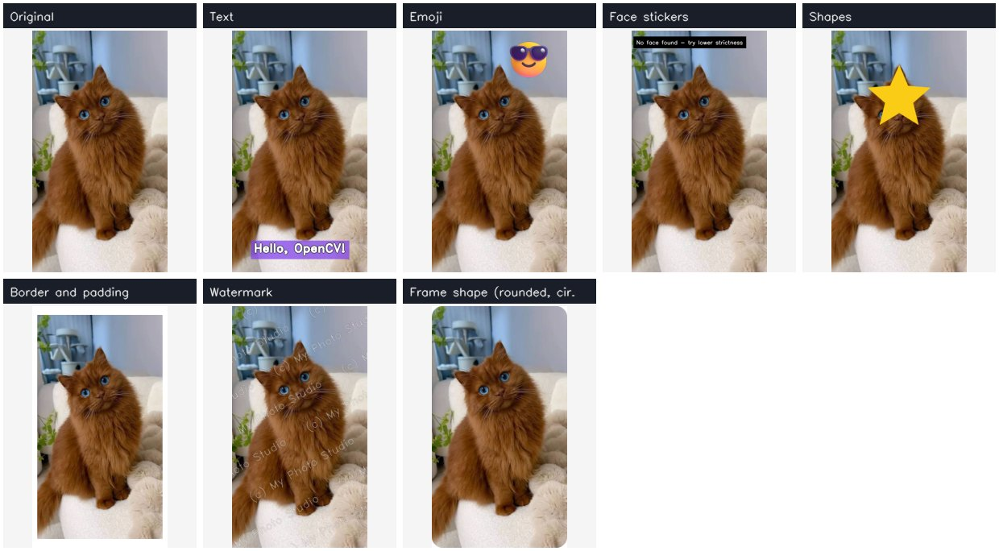</p>

| Tool | What it does | Core operations |
|---|---|---|
| Text | Any position, 7 fonts, italic, size, outline, background box with opacity | `putText`, `getTextSize`, `addWeighted` |
| Emoji | 33 emoji, position, size, rotation, mirror, opacity | Alpha blending of RGBA images |
| Face stickers | Sunglasses, mustache or crown on every detected face | Haar cascade, alpha blending |
| Shapes | Rectangle, circle, ellipse, line, arrow, star; filled or outlined | `rectangle`, `circle`, `ellipse`, `arrowedLine`, `fillPoly` |
| Border and padding | Constant, reflect, replicate or wrap, per side | `cv2.copyMakeBorder` |
| Watermark | Corner, center or tiled diagonal, transparent | `putText`, `warpAffine`, alpha blending |
| Frame shape | Rounded corners, circle or ellipse | Mask drawing and blending |

### Masks and blending

<p align="center">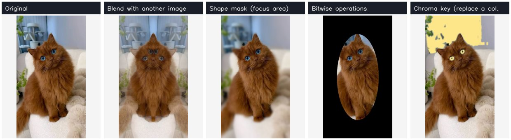</p>

| Tool | What it does | Core operations |
|---|---|---|
| Blend with another image | Weighted, add, subtract, difference, multiply, screen, lighten, darken | `addWeighted`, `add`, `subtract`, `absdiff`, `multiply` |
| Shape mask | Blur, gray, darken, pixelate or color outside (or inside) a soft shape | Mask drawing, blending |
| Bitwise operations | AND, OR, XOR, NOT with a shape or a second image | `bitwise_and`, `bitwise_or`, `bitwise_xor`, `bitwise_not` |
| Chroma key | Replaces one color with an image, a color or a blur | `inRange` in HSV, morphology |

The blend tool includes **"Add (NumPy, wraps around)"** next to **"Add (cv2.add, saturates)"** to show why
`uint8` arithmetic in NumPy overflows (250 + 10 = 4) while OpenCV clips at 255.

### Detect

<p align="center">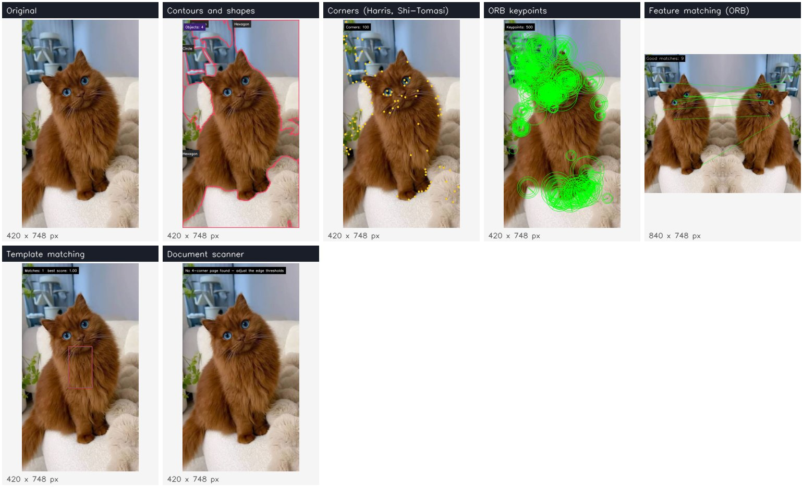</p>

| Tool | What it does | Core operations |
|---|---|---|
| Faces and eyes | Faces, eyes and smiles with counts | Haar cascades |
| Contours and shapes | Finds objects, names triangles, rectangles, circles | `findContours`, `approxPolyDP`, `boundingRect`, `minAreaRect`, `convexHull` |
| Corners | Harris or Shi-Tomasi corners | `cornerHarris`, `goodFeaturesToTrack` |
| ORB keypoints | Keypoints with scale and orientation | `ORB_create`, `drawKeypoints` |
| Feature matching | Matches the same object between two photos | ORB, `BFMatcher`, ratio test, `drawMatches` |
| Template matching | Finds every copy of a patch; shows the score map | `matchTemplate`, non-maximum suppression |
| Document scanner | Finds a page and flattens it to a top-down scan | Canny, contours, `getPerspectiveTransform` |

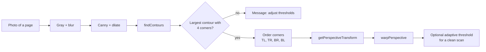

---

## Architecture

The project has three layers. `app.py` is the Streamlit interface. `studio/registry.py` defines what a tool is.
`studio/ops/` holds the tools themselves, one module per category, and none of them knows anything about Streamlit.

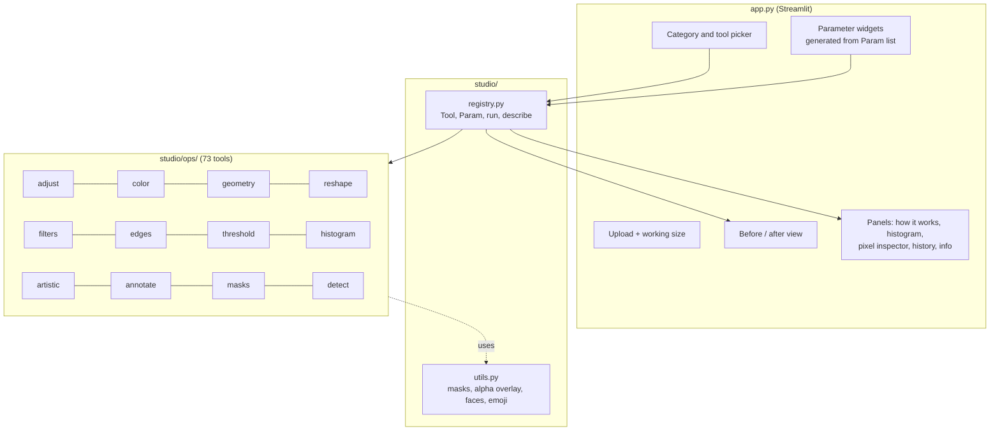

### What a tool is

A tool is a **pure function** `fn(img, **params) -> img` (BGR `uint8` in, BGR `uint8` out) registered with a
decorator that also declares its parameters. The UI builds every widget from that declaration, so adding a tool
never requires touching `app.py`.

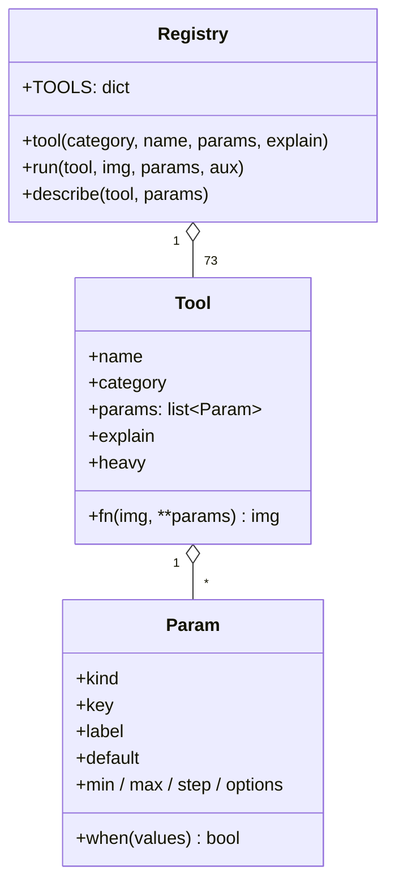

The `when` function hides parameters that do not apply: for example the fill color of **Rotate** is shown only
when the border mode is *Constant color*.

---

## How editing works

Edits are **non-destructive**. The history stores only `(tool name, parameters)` for every step, and a cache keeps
the image after each step, so undo is instant and any step can be removed and the rest replayed.

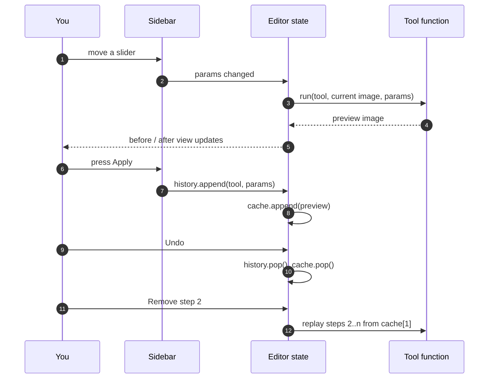

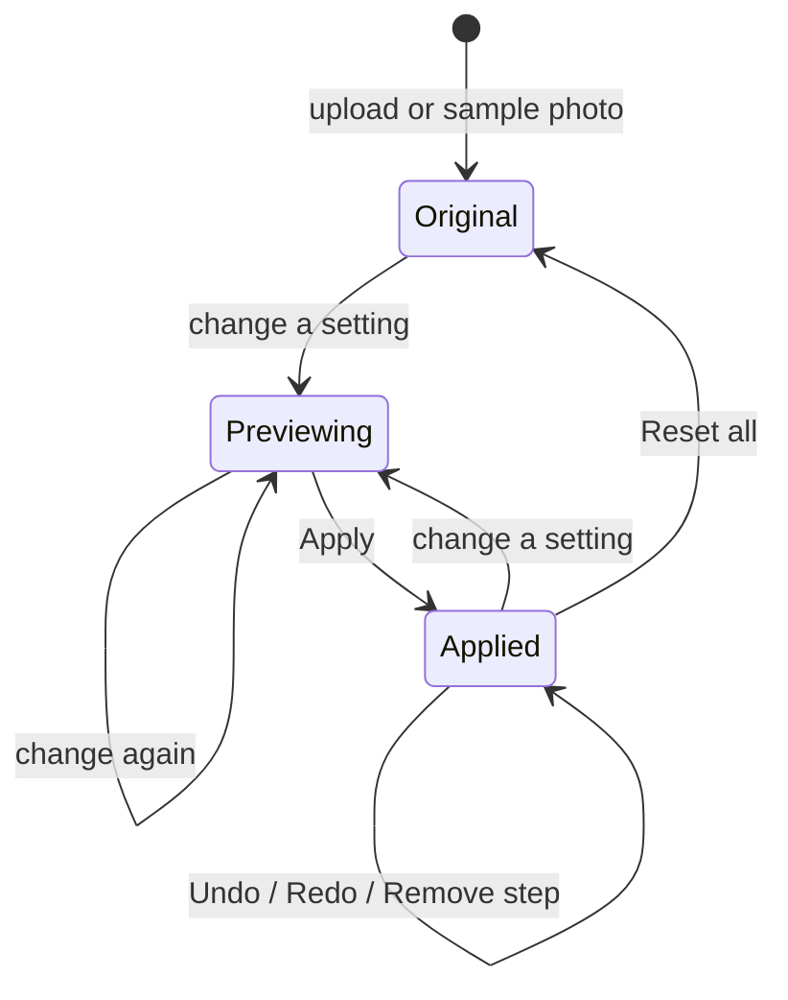

- Big uploads are scaled to a **working size** (640 to 2048 px on the longest side) so every tool stays interactive.
  Changing the working size replays the whole history on the new size.
- Previews are cached by `(history, tool, parameters)`, so switching tabs or panels does not recompute anything.
- Slow tools (non-local means denoise, stylization, detail enhance, feature matching) preview on demand.
- After **Apply**, the preview pauses until a setting changes, so the tool is never shown applied twice by mistake.

---

## Concepts covered

The tools cover all the classic image-processing topics of the course.

| Topic | Tools |
|---|---|
| Pixels, channels, color spaces | Pixel inspector, Grayscale, Color space explorer, Channels, Split channels |
| Drawing shapes and text | Shapes, Text, Watermark |
| Resizing, aspect ratio, cropping, ROI | Resize, Crop, Crop to aspect ratio |
| Padding and borders | Border and padding, border modes in Rotate, Translate, Shear and Perspective |
| Flipping, translation, rotation | Flip, Translate, Rotate, Rotate 90 degrees |
| Affine and perspective transforms | Shear, Perspective, Document scanner |
| Image arithmetic | Blend with another image, Brightness and contrast, Sharpen |
| Bitwise operations and masking | Bitwise operations, Shape mask, Color range, Chroma key, Frame shape |
| Brightness and contrast | Brightness and contrast, Gamma, Normalize |
| Histograms, equalization, normalization | Histogram panel, Histogram equalization, CLAHE, Normalize |
| Noise and blurring | Add noise, Blur, Motion blur, Denoise, Custom kernel |
| Thresholding | Threshold, Adaptive threshold |
| Edge detection | Canny, Sobel, Laplacian, Scharr, Prewitt |
| Morphology | Morphology |
| Contours | Contours and shapes, Document scanner |
| Feature detection and matching | Corners, ORB keypoints, Feature matching |
| Object detection | Faces and eyes, Template matching, Face stickers, Face size |

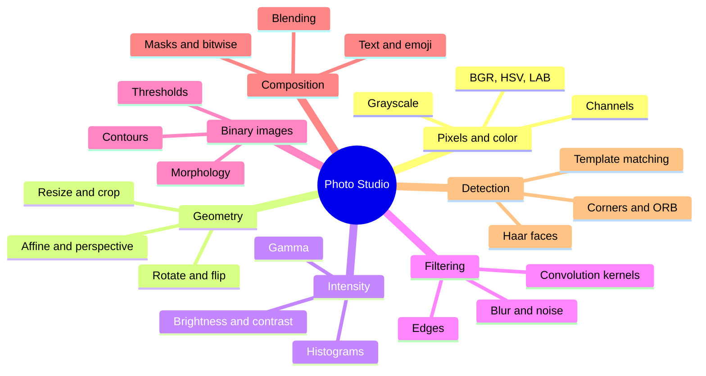

---

## Project structure

```
.
├── app.py                    Streamlit editor: sidebar, preview, history, panels
├── studio/
│   ├── registry.py           Tool and Param definitions, run, describe
│   ├── utils.py              Shared helpers: masks, alpha overlay, faces, emoji
│   └── ops/
│       ├── adjust.py         Brightness, gamma, HSV, temperature, sharpen, invert, posterize
│       ├── color.py          Grayscale, color spaces, channels, HSV color range
│       ├── geometry.py       Resize, crop, rotate, flip, translate, shear, perspective
│       ├── reshape.py        Face size, bulge, swirl, slim, height stretch
│       ├── filters.py        Blur, motion blur, noise, denoise, custom kernel
│       ├── edges.py          Canny, Sobel, Laplacian, Scharr, Prewitt
│       ├── threshold.py      Threshold, adaptive threshold, morphology
│       ├── histogram.py      Equalization, CLAHE, normalization
│       ├── artistic.py       Cartoon, sketch, sepia, vintage, pixelate, color maps and more
│       ├── annotate.py       Text, emoji, stickers, shapes, borders, watermark, frames
│       ├── masks.py          Blending, shape masks, bitwise operations, chroma key
│       └── detect.py         Faces, contours, corners, ORB, matching, document scanner
├── assets/
│   ├── sample.jpg            Photo shown before you upload one
│   └── emoji/                33 emoji images with transparency
├── docs/images/              Tool catalog images used in this README
├── .streamlit/config.toml    Theme and upload size
└── requirements.txt
```

---

## Getting started

**Requirements:** Python 3.10 or newer.

```bash
git clone https://github.com/Hagar-Ghazi/opencv-photo-studio.git
cd opencv-photo-studio
python -m venv .venv
```

Activate the environment:

```bash
# Windows
.venv\Scripts\activate
# macOS / Linux
source .venv/bin/activate
```

Install and run:

```bash
pip install -r requirements.txt
streamlit run app.py
```

The editor opens at `http://localhost:8501` with a sample photo loaded.

> OpenCV is pinned below version 5 on purpose. OpenCV 5 moved Haar cascades out of the main package, and the
> face tools depend on them.

---

## Using the editor

1. **Upload a photo** in the sidebar (JPG, PNG, WEBP, BMP or TIFF), or start with the sample photo.
2. **Pick a category**, then a **tool**. Its settings appear below it.
3. Move the sliders and watch the **After** image update.
4. Press **Apply** to keep the change. Repeat with other tools to build up an edit.
5. Use **Undo**, **Redo**, **Reset all**, or the **History** panel to remove or go back to any step.
6. **Download** the result as PNG or JPG.

| Panel | Use it to |
|---|---|
| How it works | Read what the current tool does and see its code |
| Histogram | Compare the value distribution before and after |
| Pixel inspector | Read the exact values of one pixel in five color spaces |
| History | See every applied step, remove one, or go back to it |
| Image info | Check size, aspect ratio, NumPy shape and file sizes |

Tools that need a second image (blending, bitwise with an image, chroma key background, feature matching,
template matching) show an extra uploader in the sidebar.

---

## Deploying to Streamlit Community Cloud

1. Push this repository to GitHub.
2. Sign in at [share.streamlit.io](https://share.streamlit.io) with your GitHub account.
3. Click **Create app**, choose this repository, branch `main` and main file `app.py`.
4. Deploy. Dependencies come from `requirements.txt`, which uses `opencv-python-headless` because cloud
   servers have no display.

No secrets or extra services are needed: everything runs on the uploaded image inside the app.

---

## Adding a new tool

Create a function in the right module under `studio/ops/` and register it with the `tool` decorator:

```python
import numpy as np

from studio.registry import Param as P
from studio.registry import tool


@tool("Adjust", "Solarize", [
    P("slider", "threshold", "Threshold", 128, 0, 255, 1),
], explain="""
Pixels brighter than the threshold are inverted, like an over-exposed film.
""")
def solarize(img, threshold):
    return np.where(img < threshold, img, 255 - img).astype(np.uint8)
```

The new tool appears in the sidebar with its slider, works with Apply, Undo and History, and gets its own
How it works panel. No change to `app.py` is needed.

---

## Design decisions

| Decision | Reason |
|---|---|
| Tools are pure functions on BGR `uint8` images | Easy to test, chain, replay and reuse outside Streamlit |
| Parameters are declared, not hand-written widgets | The UI, history labels and defaults all come from one place |
| Positions and sizes are percentages | Settings stay meaningful when the working size changes |
| Single-channel results are converted back to BGR | Every tool can follow every other tool in the history |
| A working size limit | Keeps live preview fast for 12-megapixel phone photos |
| Emoji are PNG images, not font glyphs | OpenCV's Hershey fonts cannot draw emoji; images also look the same on every server |
| Failures are shown on the image | A tool that finds no face or no page says so instead of failing silently |

---

## Troubleshooting

| Problem | Fix |
|---|---|
| `AttributeError: module 'cv2' has no attribute 'CascadeClassifier'` | OpenCV 5 is installed. Run `pip install "opencv-python-headless<5"` |
| "No face found" | Haar cascades need a frontal, well-lit human face. Use **Manual point** in Face size, or lower the detection strictness |
| Arabic or other non-Latin text shows as question marks | OpenCV's built-in Hershey fonts support only basic Latin characters |
| A tool feels slow | Lower the working size in the sidebar, or turn off live preview for that tool |
| Document scanner finds no page | The page needs four visible edges on a contrasting background; adjust the edge thresholds |

---

## Tech stack and credits

| Library | Role |
|---|---|
| [Streamlit](https://streamlit.io) | Web interface |
| [OpenCV](https://opencv.org) | All image processing |
| [NumPy](https://numpy.org) | Array math, remapping grids, noise |
| [pandas](https://pandas.pydata.org) | Histogram chart data |

Emoji images come from [Microsoft Fluent Emoji](https://github.com/microsoft/fluentui-emoji) (MIT License).

Built as a project for the ITI *Computer Vision and Pretrained Models* course, using only the classic
computer vision part of the material.
